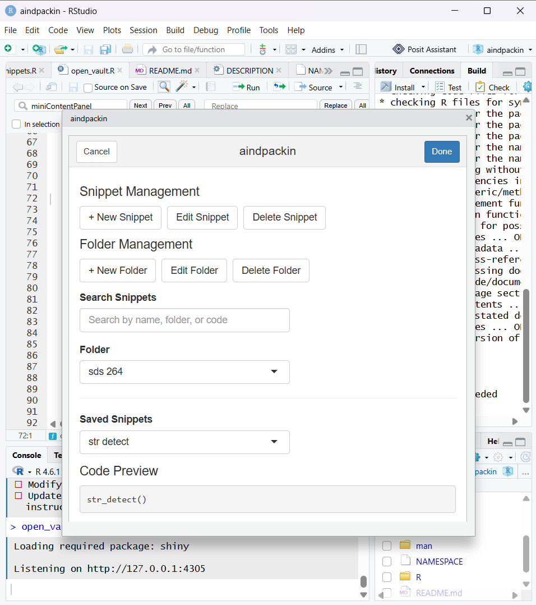

# aindpackin

<!-- badges: start -->
<!-- badges: end -->


**aindpackin** is an RStudio Addin for saving, organizing, and reusing R code snippets.

It provides an interactive interface that allows users to create, edit, delete, search, and insert reusable code directly into RStudio.

## Interface Preview



### Key Features

- Save reusable R code snippets.
- Organize snippets into custom folders.
- Create, rename, and delete folders.
- Search snippets by name
- Edit and delete existing snippets.
- Preview code before inserting it.
- Insert saved code directly into the RStudio editor.
- Automatically preserve snippets between sessions.
- Launch directly from RStudio's Addins menu.


## Installation


You can install the development version of **aindpackin** from GitHub:

```r
install.packages("remotes")
remotes::install_github("AindAH123/aindpackin")
```

After installation, load the package:

```r
library(aindpackin)
```

Launch the snippet manager:

```r
open_vault()
```

Alternatively, open RStudio's **Addins** menu and select **aindpackin - Open Snippet Manager**.


## Example


To use **aindpackin**, open RStudio and create or open an R script.

Load the package and launch the snippet manager:

```r
library(aindpackin)
open_vault()
```

### Creating a Snippet

1. Click **+ New Folder** to create a folder.
2. Click **+ New Snippet**.
3. Enter a name for your snippet.
4. Select the folder where you want to save it.
5. Enter your R code.
6. Click **Save Snippet**.

For example, save this code as "Remove Missing Values":

```r
my_data <- na.omit(my_data)
```

### Using Saved Snippets

1. Open the snippet manager.
2. Select a folder.
3. Choose a saved snippet.
4. Review the code preview.
5. Click **Done** to insert the code into your active RStudio script.

